# Triki Skate

**Turn a Żabka Triki motion sensor into a skateboard trick tracker — and a fingerboard game you play with your hand.**

Clip a Triki onto your deck, open the site on your phone, and go skate. Triki Skate notices when you pop, follows the board through the air, figures out whether that was an ollie, a kickflip or a pop shuvit, measures how high it went and whether you landed it — and then plays the trick back in 3D, frame by frame, on a timeline you can scrub with your thumb.

It runs entirely in the browser, on the stock Triki firmware. No flashing, no app store, no account. If you have a Triki and a phone, you can use it.

**▶ Open the site:** https://vadimkln.github.io/Triki-Skate/
(there is a demo button if you don't have a Triki with you)

  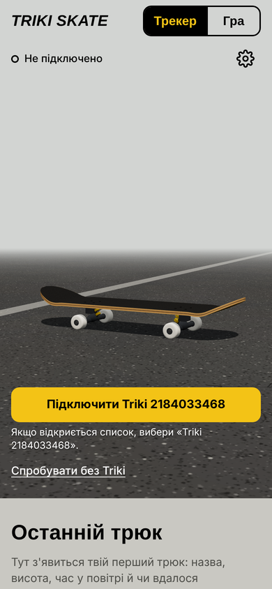
  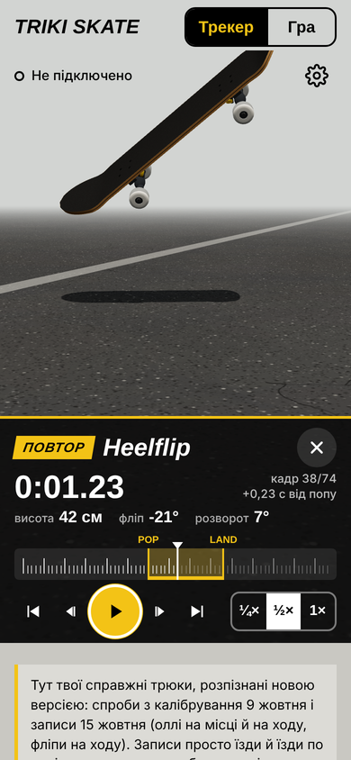
  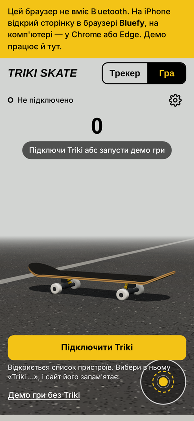

---

## What it does

**Tracker mode.** The Triki rides on the board. Every time you pop, the site waits for the landing, works out the rotation and tells you what you did: Ollie, Kickflip, Heelflip, BS/FS pop shuvit, 360 shuvit, varial and hardflip combos, 360 flip, laser flip, impossible, and doubles. It shows the air time and height, marks a bail if the board came down on its side or upside down, and keeps a session list with stats — tricks, landing rate, best height. Tap any trick to open the replay: the board flies exactly as the sensor measured it, with POP and LAND marks on a timeline, slow motion (¼×, ½×, 1×), frame stepping, and a camera you can orbit with your finger.

**Game mode.** The Triki goes in your hand and becomes a fingerboard. Rest it on your index finger, press the "tail" with your thumb to pop, flip or spin it, and bring it back level. The board on screen stays still while you move, and when the gesture is recognised it plays the trick, scores it and builds a combo. There's free play and a game of S.K.A.T.E. against the site.

**Also:** Ukrainian, English and Polish; remembers your Triki and reconnects on its own; optional GPS speed; session export; raw-data recording for anyone who wants to dig into the numbers.

## What you need

- A Żabka **Triki** (stock firmware is fine).
- **iPhone:** the free **Bluefy** browser from the App Store — Safari has no Web Bluetooth.
- **Android / computer:** Chrome or Edge.
- Close the Żappka app first: Triki talks to one device at a time.

## How to use it

1. Open the site and tap **Connect Triki**. The first time, a list of all nearby devices opens — pick "Triki …". The site remembers it and connects by itself next time.
2. Put the Triki on the board and run **Settings → Triki position**: hold the board flat, then lift the nose. This takes ten seconds and tells the site which way is the nose. (If you later move the Triki and forget to redo it, the site notices from your pops and flips and corrects itself.)
3. Pick your stance — Regular (left foot forward) or Goofy (right foot forward). Kickflip and heelflip are mirror images, so this matters.
4. Run **Settings → Speed test** once, holding the Triki in your hand and moving it gently. It finds the fastest rate your phone can actually receive.
5. Skate.

---

## How it works, in plain words

The Triki streams a 3-axis accelerometer (±16 g) and a 3-axis gyroscope (±2000 °/s) over Bluetooth. Everything else is interpretation, and every rule below was checked against real recordings:

- **Pop** — the tail hits the ground (2.6 g or more) and the board immediately starts to rotate nose-up. Cracks, tiles and curbs hit just as hard, but they don't make the board spin, so they don't count.
- **In the air** — the wheels aren't pushing on the board any more. Interestingly, the board is rarely weightless: your feet press on it from above, sometimes with up to 8 g. So "in the air" means "no force from below", not "free fall".
- **Landing** — out of a cluster of hits, the one where the ground pushes the board up hardest, after which it stops spinning within a third of a second. A foot stomp in mid-air isn't a landing; the board keeps turning after it.
- **Rotation** — the gyroscope is integrated through the flight and split into a flip (around the board's long axis), a spin (around the vertical) and a pitch. Kickflip vs heelflip comes from the flip direction and your stance; shuvit direction from the spin.
- **Height** — from air time, like a thrown ball: h = g·t²/8.
- **Replay** — the flight is re-integrated carefully, and at the landing the board must be flat on four wheels. Whatever small error the gyroscope collected is corrected where the board was spinning fast, so slow moments of the flight — a nose held down, say — stay exactly as measured.
- **On the ground** the live 3D board lies flat on its wheels and only turns to follow your heading, so tiles and acceleration don't make it shake or lift the nose.

---

## The story so far

This project was built in about a week of evenings, mostly by skating, recording, and staring at graphs. Here is how it got here — including the dead ends.

### Day 1 — a Python lab on the PC

It started with a question: can a cheap motion toy from a convenience store tell a kickflip from a shuvit?

The Triki speaks Nordic UART over Bluetooth (thanks to [Wojtekb30/unofficial-triki-api-py](https://github.com/Wojtekb30/unofficial-triki-api-py) for documenting the protocol). The first tools were Python scripts for Windows: a logger that saved raw data to CSV, a simulator that generated fake skate sessions (vibration, drift, pops, flips, clipped gyro peaks, lost packets) so the analyser could be tested before any real tricks existed, an offline analyser that rebuilt an even time base, repaired clipped peaks and searched for pop → flight → landing, and a live window with a 3D board and signal plots.

  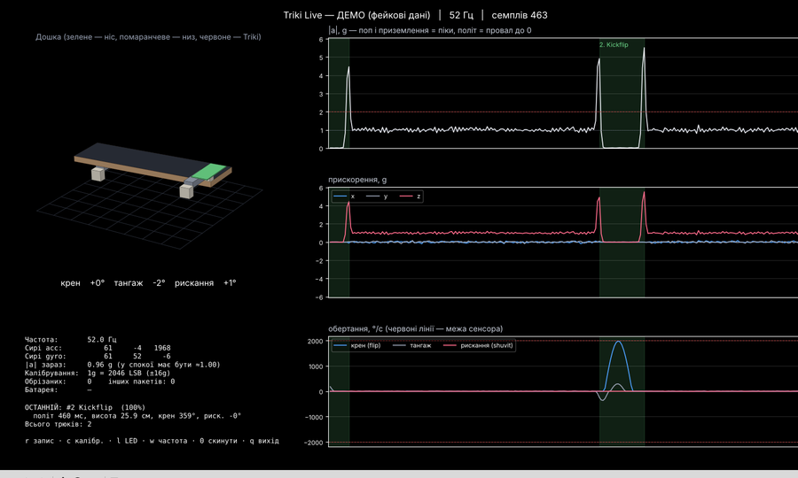
  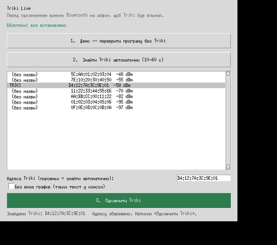

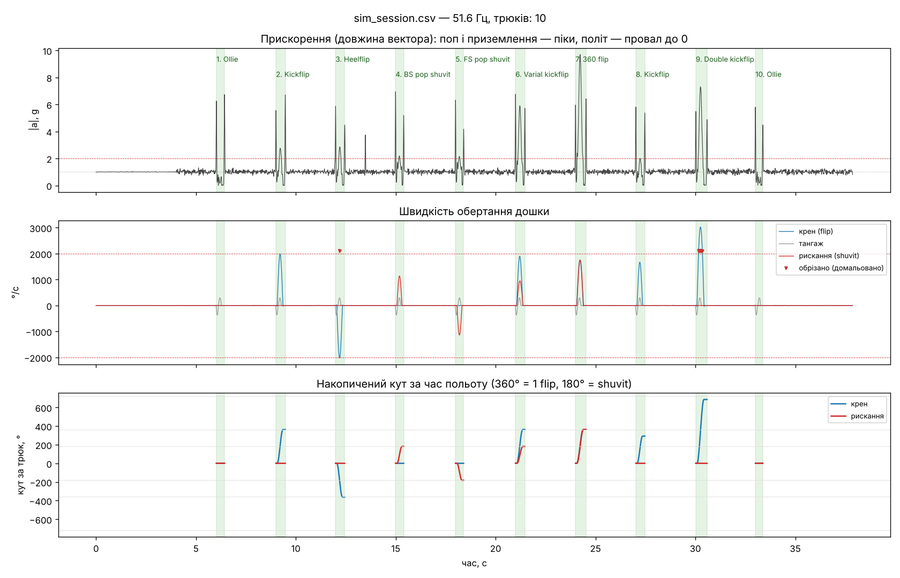

Two problems showed up straight away. The Triki **falls asleep** when it thinks nobody's playing, so the tools gained keep-alive experiments (re-sending the start command, blinking the LED, reading the battery). And **Windows couldn't hold the connection** steadily. For a while the plan was custom firmware that records tricks into the Triki's own memory and dumps them later — but that would mean nobody else could use it. The decision: stay on stock firmware and move to the phone.

### Day 2 — into the browser

Web Bluetooth made the phone version possible without an app. The first web page, "Triki Live", was a straight port of the PC tools; a few hours later it became a proper app with a 3D board on asphalt, a "last trick" card, session stats and settings.

  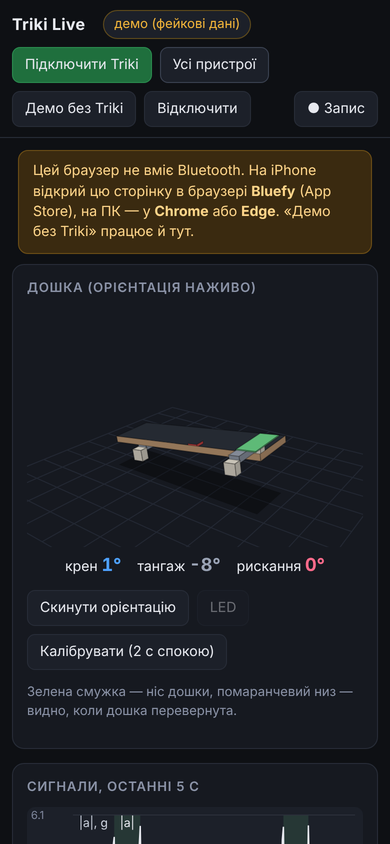
  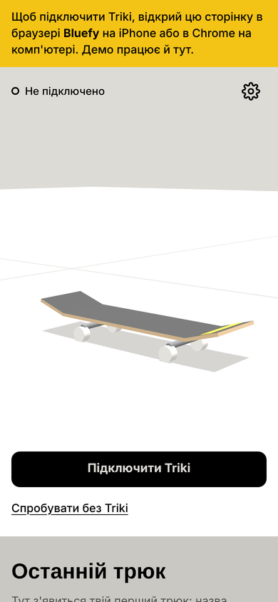
  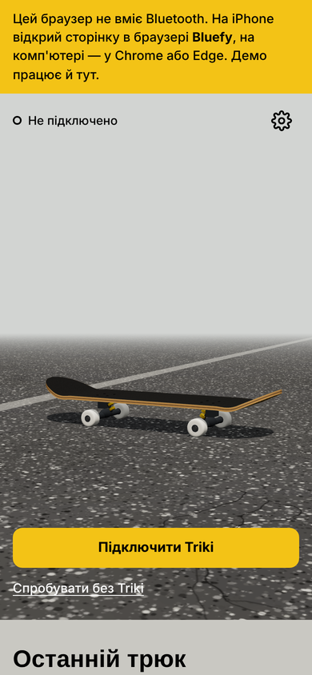

On iPhone it has to run in Bluefy, and Bluefy shows an empty list when you filter devices by name — so connecting goes through the full device list, and the site remembers the chosen Triki and reconnects on its own after that. The same day brought three languages, the mount wizard, a deterministic demo (real-looking tricks instead of random noise, with a way to actually leave it), and the replay viewer with a skate-video-style timeline.

  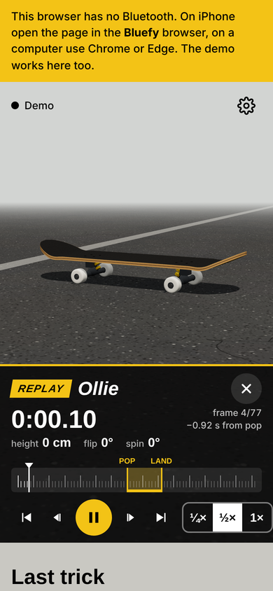
  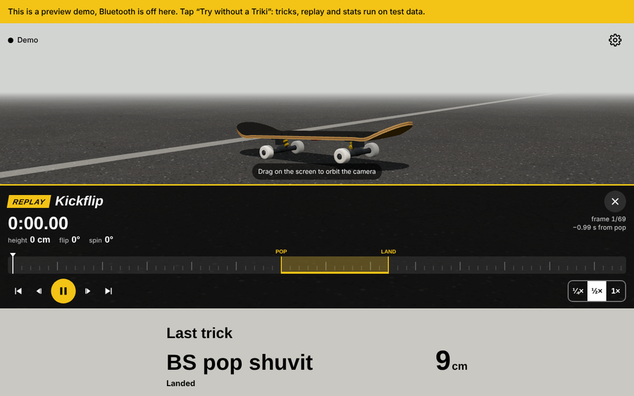

### Trick calibration

Here's a problem you only notice once you try: which way does a kickflip spin *in the sensor's numbers*? It depends on how the Triki is mounted, which end is the nose, and your stance. Rather than guess, the site got a temporary **calibration mode**: choose a trick, tap Record, and do it 5–10 times; the site stored every attempt with its raw data, and you could apply the result so the classifier learned which way your kickflip, heelflip and both shuvits turn.

  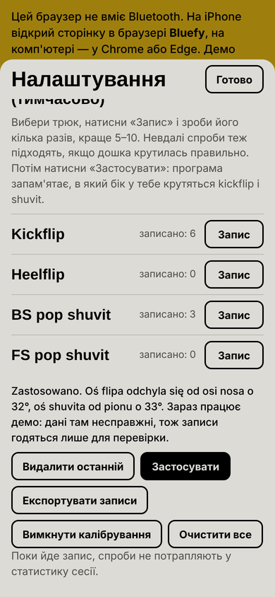
  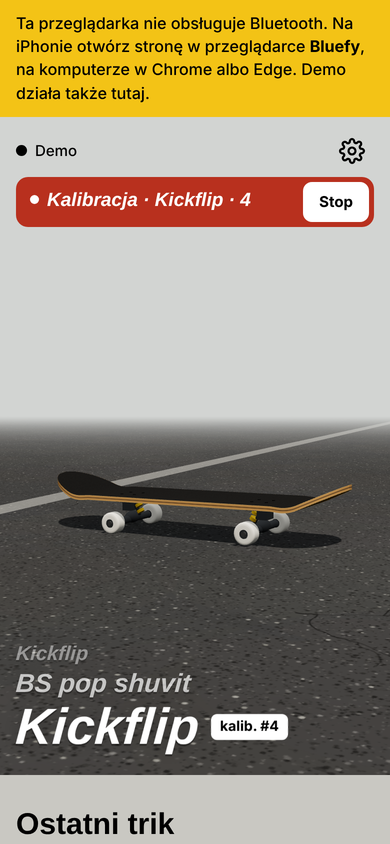

The first real calibration session — about forty kickflips, heelflips and shuvits, ridden to the spot and done standing — taught a lot. Riding vibrations were faking pops. Landings looked like the board touched down on two wheels and slowly rolled flat, when in real life it slaps down on all four. Both got fixed, those attempts were loaded into the demo so their replays could be watched, and once the directions were clear the calibration mode was removed again. (It turned out later that this session also hid a bug — see "Kickflip or heelflip?" below.)

### The game

Then a new idea: what if the Triki *is* the skateboard? In game mode you hold it like a fingerboard — on the side of your index finger, thumb on top — and press one end to pop. The on-screen board deliberately doesn't follow your hand; it only performs the trick once the gesture is finished, the way a skate game would.

  
  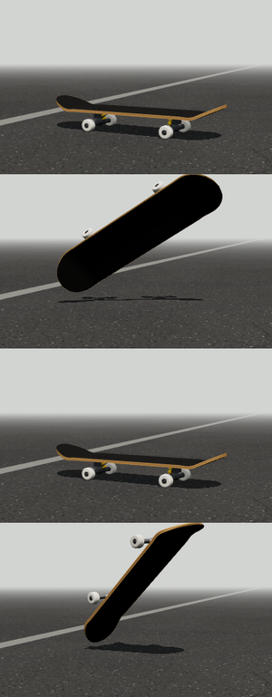

Getting it to feel right took some work: the nose is whichever end rises (not a fixed axis), rotation had to be integrated exactly because a fast flip covers 60° between two samples, the accelerometer is ignored mid-spin, and Bluetooth delivers samples in bursts, so the game keeps its own clock instead of trusting the wall clock.

### Day 8 — real rides, real problems

Five labelled recordings — plain riding, ollies while rolling, ollies standing, flips while rolling, and a rough road with curbs — showed what the tidy calibration session hadn't:

- **The phone gets only 10–25 samples per second**, unevenly, in bursts, with pauses of up to 4.5 seconds. The old code assumed a steady ~26 per second, so flips came out about a quarter short. Now every sample carries its own arrival time and all the maths uses real time.
- **Some packets arrive shifted** — the same six numbers rotated a few places, which looks exactly like a moment of weightlessness with a violent spin. They're detected and dropped.
- **Not a single ollie was being detected.** The old rule looked for free fall, but on a real board your feet press it the whole time. The new rule looks for "no push from the wheels".
- **Foot stomps in the air were taken for landings.** Now the landing is the strongest push from below in a cluster of hits.
- **At the moment of impact the gyroscope "rings"** — up to 2000 °/s for one sample. Those samples are skipped.
- **The Triki had been moved on the board** by about 130° since setup. The site now learns the real nose direction from the first flip, or from two ollies, and fixes the setup by itself.

The result on those recordings: two ollies out of two, two out of two, three flips out of three, and zero false tricks on both riding recordings.

### Kickflip or heelflip?

Then the flips all came out as heelflips — and they were kickflips. The rotation directions for regular and goofy had been mirrored from the start. The physics is simple once you look it up: in a kickflip the front foot slides toward the heel side, and a regular rider's board turns clockwise when you look at it from the nose; a backside shuvit sends the tail behind your back. The calibration session hadn't caught it because there, too, the names had come out mirrored. An extra kickflip recorded on the spot confirmed the fix.

### Shaky board on tiles

Riding on paving tiles made the live 3D board tremble and hop, and sometimes it lifted its nose on its own. The cause: every tile joint jolts the accelerometer, and speeding up or braking tilts the "up" it reports. Now the board lies flat while it's on the ground and only starts moving freely when it pops. On the rough-road recording the largest tilt went from 37° to 7°, and the hops from 18 cm to 2 cm.

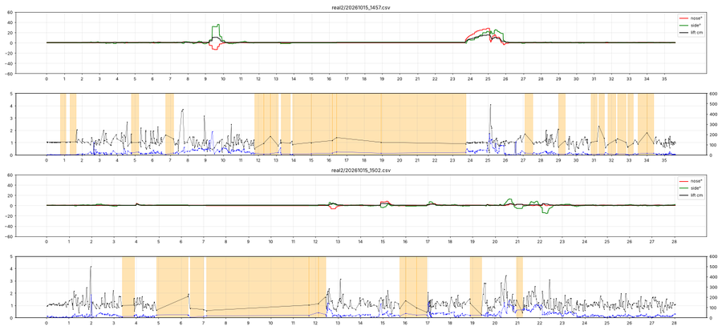

Along the way it turned out the phone had been running a mix of old and new files from its cache. The site is now shipped as one bundled `app.js` with the version in its address, and the version is shown under **Settings → Diagnostics**.

### Chasing a better replay

The latest problem: heights a bit random, a slight sideways twist in ollie replays, and a nose-down moment in the air that never showed up on screen. At ~20 samples per second an ollie is about 12 samples long and the board turns 20–25° between two of them, so detail simply falls through the gaps. Then came the surprise: the number in the Triki's start command isn't a rate in hertz at all — it's the interval between packets. The site had been sending "104", like the official app, assuming it meant 104 Hz. On a PC, smaller values reached about 110 samples per second. The new **speed test** finds the best value for your phone. The replay was also improved: the board stays flat before the pop, the flight is integrated more accurately, and the landing correction is placed where the board was spinning fast.

---

## Problems and fixes, at a glance

| Problem | What was going on | Fix |
|---|---|---|
| Triki falls asleep | Stock firmware sleeps when idle | Keep-alive option, automatic reconnect |
| Windows drops the connection | Unstable BLE on the PC | Moved to the phone (Web Bluetooth, Bluefy) |
| Bluefy shows no devices | Name filter returns an empty list | Pick from the full list once, then reconnect automatically |
| Riding vibrations faked pops | Hits alone were treated as pops | A pop must be followed by rotation |
| Landing looked like two wheels and a slow roll | Orientation trusted the accelerometer too slowly | Board is set flat on landing; error spread over the flight |
| Flips came out a quarter short | Real rate 10–25/s, uneven; code assumed a fixed rate | Real timestamps for every sample |
| Fake weightless spikes | Shifted packets from Bluetooth | Detected and dropped |
| No ollies detected | Feet press the board, so no free fall | "No push from the wheels" instead of free fall |
| Stomps taken as landings | First hit in a cluster was chosen | Strongest push from below wins |
| Wrong trick names after moving the Triki | Mount had changed by ~130° | Auto-correction from pops and flips |
| Kickflip shown as heelflip | Regular/goofy directions mirrored | Directions fixed against the trick definitions |
| Phone ran old code | Cached modules mixed old and new files | One versioned bundle, version shown in settings |
| Board shook and lifted its nose on tiles | Accelerometer tilt while riding | Board held flat on the ground |
| Coarse in-air replay | Too few samples per second | Speed test; better integration and landing correction |

## Limitations and what's next

- Air-time height is approximate: the board isn't really a thrown ball. With faster sampling the plan is to compute height from the measured forces instead.
- A manual (riding on the back wheels) is shown as a flat board in the live view; the ground lock can't tell it apart from a tilt error yet.
- Stance can't be detected, so set it in the settings.
- Not every phone receives the same rate; run the speed test.

## Project structure

| Path | What's inside |
|---|---|
| `index.html`, `css/app.css` | Page layout and styles |
| `app.js` | Everything from `js/` bundled into one file — this is what the page loads |
| `js/sensor.js` | Packet parsing, board axes, live orientation, takeoff |
| `js/tricks.js` | Trick detection and naming, automatic mount correction |
| `js/replay.js`, `js/viewer.js` | Replay track and the timeline viewer |
| `js/game.js`, `js/gameui.js` | Fingerboard game |
| `js/ble.js` | Bluetooth, remembered device, speed test |
| `js/scene.js`, `js/board.js`, `js/textures.js` | 3D scene, board model, asphalt |
| `js/session.js`, `js/ui.js`, `js/i18n.js`, `js/demo.js`, `js/gps.js`, `js/math.js`, `js/util.js` | Sessions, interface, three languages, demo, GPS, maths |
| `vendor/` | three.js r160 |
| `models/` | Drop your own `board.glb` here |
| `docs/history/` | Screenshots from earlier versions |

To update the live site, upload the new files (most importantly `index.html` and `app.js`), wait a minute, and check **Settings → Diagnostics → Site version**.

## Credits

Protocol notes: [Wojtekb30/unofficial-triki-api-py](https://github.com/Wojtekb30/unofficial-triki-api-py). 3D: [three.js](https://threejs.org).

This is a fan project. It isn't affiliated with or endorsed by Żabka; "Triki" and "Żappka" belong to their owners.
